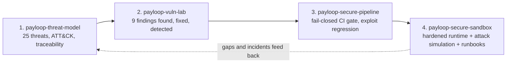

# payloop-secure-sandbox: a payments API secured across the whole SDLC

The flagship of a four-repository portfolio. **PayLoop** is a fictional mobile-money wallet API (PHP 8). This repository runs the
**hardened build** in a locked-down container stack, fires ten realistic attacks at it, and shows for each one whether it was
blocked and which Wazuh detection fired. Everything is synthetic; nothing here comes from a real system.



## See it work (no Docker needed: PHP 8.1+ with pdo_sqlite, Python 3.10+, `pip install pyyaml`)
```bash
make demo     # 10 attacks vs the hardened app: blocked? which rules fired? (about 30 seconds)
make test     # exploit regression, SSRF guard, detection suite, simulation
make mutate   # break the detection rules on purpose; the suite must go red every time
make run      # or just start the app on http://127.0.0.1:8080
```
Docker (not run when this was written, validated statically only): `export PAYLOOP_TOKEN_SECRET=$(openssl rand -hex 24); make up; make seed`.

## What the simulation shows
Generated by `make demo`; every row is a real request sequence against the running app, and the alerts come from replaying the app's own log through the rules.

<!-- demo:start -->
| ID | Scenario | ATT&CK | Attacker | HTTP results | Detection rules fired | Max level | Example alert |
|---|---|---|---|---|---|---|---|
| S1 | Password spraying | T1110 | blocked | 401x10 | 110101, 110111 | 10 | PayLoop: possible brute force or password spraying, 8+ failed logins in 60s from 203.0.113.10. |
| S2 | Brute force on one account | T1110 | blocked | 401x5 429x7 | 110101, 110103, 110113 | 10 | PayLoop: login throttled for dave from 203.0.113.11. |
| S3 | SQL injection (UNION) | T1190 | blocked | 200 | 110120 | 10 | PayLoop: SQL injection pattern in request to /statement from 203.0.113.12. |
| S4 | Path traversal | T1190 | blocked | 404 | 110121, 110122 | 10 | PayLoop: file access blocked by validation (../internal/notes.txt) from 203.0.113.13. |
| S5 | SSRF (loopback, metadata, file://) | T1190 / T1552.005 | blocked | 400x3 | 110130 | 10 | PayLoop: outbound request to 127.0.0.1 blocked (ip_literal_not_allowed) for alice. |
| S6 | IDOR enumeration of wallets | T1213 | blocked | 404x6 | 110105, 110141 | 9 | PayLoop: repeated authorisation failures by alice, possible access-control probing. |
| S7 | Transfer from another customer's wallet | T1657 | blocked | 404x3 | 110105, 110141 | 9 | PayLoop: repeated authorisation failures by alice, possible access-control probing. |
| S8 | Negative and zero transfer amounts | T1657 | blocked | 422x2 | 110153 | 10 | PayLoop: transfer REJECTED with zero or negative amount (-5000) by alice, manipulation attempt. |
| S9 | Replayed payment request | T1657 | blocked | 201 200 | 110152 | 5 | PayLoop: duplicate transfer submission absorbed by idempotency key replay-0001-abcd. |
| S10 | Forged admin token (old leaked secret) | T1606 | blocked | 401x6 | 110160, 110161 | 11 | PayLoop: invalid session token presented (bad_signature) from 203.0.113.19. |
<!-- demo:end -->

## How it is secured, by SDLC stage
Full map with evidence and threat links: [`docs/sdlc-security-map.md`](docs/sdlc-security-map.md).

| Stage | What exists here |
|---|---|
| Design | Threat model with attack tree and risk register (companion repo) |
| Code | Prepared statements, one central authorisation guard, `SsrfGuard`, strict input validation, fail-closed secret loading, generic errors |
| Test | 9 historical exploits replayed on every run, 25 SSRF bypass cases, detection suite with false-positive controls, attack simulation |
| Deploy | Non-root, read-only root fs, `cap_drop: ALL`, `no-new-privileges`, nginx rate limits and headers, DB `CHECK` and foreign keys |
| Operate | Structured JSON security log, 29 Wazuh rules tagged to ATT&CK, agent config snippet |
| Respond | Seven runbooks: triage questions, queries, containment, false positives, escalation |

## Read next
[`docs/architecture.md`](docs/architecture.md) | [`docs/runbooks.md`](docs/runbooks.md) | [`docs/demo-script.md`](docs/demo-script.md) | [`docs/interview-qa.md`](docs/interview-qa.md)

## Honest limits
- **Verified here:** the app, exploit regression, SSRF guard cases, detection suite and mutation checks, the attack simulation, YAML and Compose syntax, and the Dockerfile with checkov.
- **Not verified here:** the container build and compose stack (no container runtime was available), the Wazuh rules on a live manager (offline simulator only; procedure in `payloop-vuln-lab/docs/WAZUH-VALIDATION.md`), and GitHub Actions execution.
- **Simplifications:** SQLite and one node, plain HTTP on localhost, stateless tokens with no per-token revocation, no MFA, no signed partner callbacks. All are recorded as open or partial threats rather than hidden.
- **Side effect worth knowing:** the per-username login throttle can be used to lock a victim out for five minutes (TM-17, accepted). The simulation hit this by accident when brute-forcing a user that a later scenario needed.
