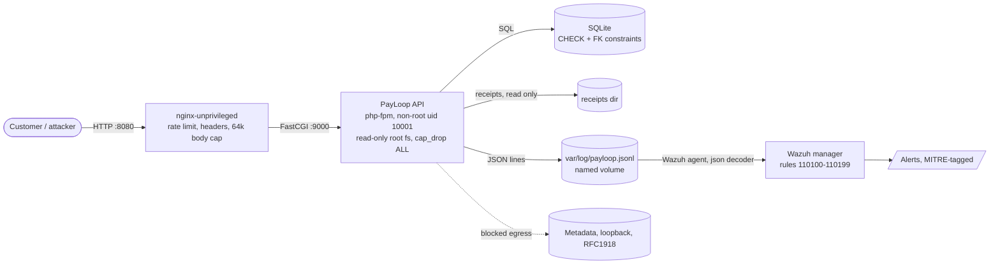

# Architecture

## What runs where
| Component | Hardening | Why |
|---|---|---|
| nginx-unprivileged | Non-root, read-only fs, `limit_req` 10 r/s per IP, security headers, `server_tokens off`, 64 KB request cap | Absorbs crude floods and removes easy fingerprints before PHP sees a request |
| php-fpm app | Non-root uid 10001, code root-owned and not writable, only `var/` writable, `cap_drop: ALL`, `no-new-privileges`, dangerous PHP functions disabled, `display_errors` off | A code-execution bug lands in a box that cannot write code, escalate or shell out |
| SQLite | `CHECK (balance_minor >= 0)`, `CHECK (amount_minor > 0)`, foreign keys on every wallet reference | The database refuses impossible states even if an application check is missed |
| Log | One JSON line per event, request id on every line, never request bodies or secrets, separate volume | Gives the SIEM structured evidence and keeps secrets out of logs |
| Secret | `PAYLOOP_TOKEN_SECRET` from the environment; app refuses to run without 32+ chars | Fixes the hard-coded-secret class of bug by construction |

## Request path and log events
1. nginx applies rate limits and passes the real client address as `REMOTE_ADDR`.
2. The front controller assigns a request id, logs a `request` line when the response is sent (method, path, decoded query, status).
3. Handlers add specific events: `login_failed`, `login_rate_limited`, `authz_denied`, `ssrf_blocked`, `path_blocked`, `transfer_rejected`, `transfer_duplicate`, `auth_token_invalid`, `admin_access`, `app_error`.
4. Rules in `monitoring/wazuh/payloop_rules.xml` turn those events into MITRE-tagged alerts; each alert has a runbook entry in `docs/runbooks.md`.

## Deliberate simplifications (stated, not hidden)
- **SQLite and a single node.** Row-level locking and replication are production concerns. `BEGIN IMMEDIATE` makes check-then-update atomic here.
- **Plain HTTP on localhost.** TLS belongs at the real edge. Threat TM-23 is marked partial for this reason.
- **Stateless tokens.** No per-token revocation; the emergency control is rotating `PAYLOOP_TOKEN_SECRET`, which signs everyone out.
- **No MFA, no signed partner callbacks.** Recorded as open items TM-02, TM-22, TM-24 in the threat model.
- **Container files were validated statically only** (checkov, `docker compose config`); the daemon was not available when this was written.
